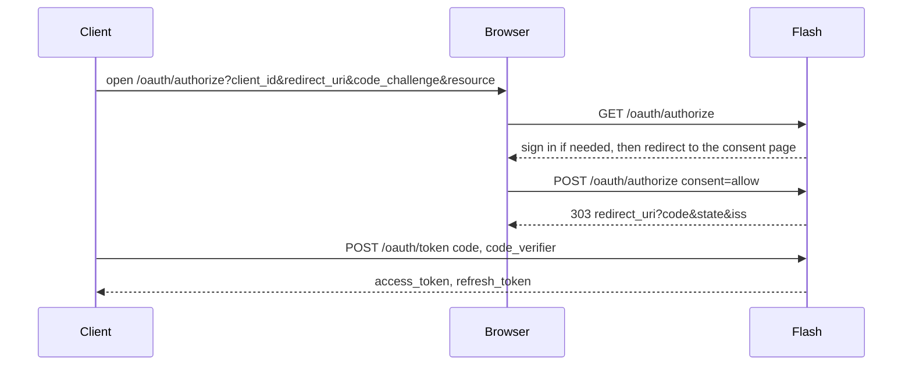

# Endpoints and flows

The issuer is the application's origin (`Security.origin(req)`).

| Endpoint | Path |
|---|---|
| Authorization | `GET`, `POST /oauth/authorize` |
| Consent details | `GET /oauth/authorize/request` |
| Token | `POST /oauth/token` |
| Revocation | `POST /oauth/revoke` |
| Registration | `POST /oauth/register` (when enabled) |
| Keys | `GET /oauth/jwks` |
| Metadata | `GET /.well-known/oauth-authorization-server` (RFC 8414) |

The metadata endpoints and the token, revocation and registration endpoints answer CORS requests
(`GET`, `POST`, `OPTIONS`; headers `Authorization` and `Content-Type`) from any origin.

Token, revocation and registration answers carry `Cache-Control: no-store`.

## Authorization code with PKCE

`/oauth/authorize` requires a signed-in user: otherwise the application's normal entry point runs.
The request must have `response_type=code`, `code_challenge` with `code_challenge_method=S256`, and
the client must be registered for `authorization_code`. Anything else is redirected back with an
error: `unsupported_response_type`, `unauthorized_client`, `invalid_request`, `invalid_target`, or
`access_denied` when the user refuses.

An unknown client or an unregistered `redirect_uri` is answered `400` and never redirected.

**Consent.** A user who consented before to that client for a scope that covers the request skips
the page. Otherwise the browser is sent to the consent page (`/consent` by default) with the original
query string. The page reads `GET /oauth/authorize/request?<same query>`, which returns JSON
(`client_id`, `client_name`, optionally `client_uri` and `logo_uri`, `redirect_uri`, `scope`,
`resource`), and posts the same parameters plus `consent=allow` or `consent=deny` to
`/oauth/authorize`. A POST with an `Origin` header other than the issuer is `403`.

Successful authorization redirects (`302` when consent was remembered, `303` after a POST) to the
client's redirect URI with `code`, `state` if sent, and `iss` (RFC 9207).

A code lasts 1 minute and is stored only as its SHA-256.

## Token endpoint

The client authenticates as registered: `client_secret_basic`, `client_secret_post`, or, for a
public client, `client_id` alone (`none`). A failure is `401 invalid_client`.

| `grant_type` | Behavior |
|---|---|
| `authorization_code` | Needs the code, the same `redirect_uri` if the request named one, and the `code_verifier`. Issues access and refresh tokens |
| `refresh_token` | Rotates: the token used is spent and a new one is issued. A request may narrow the scope, never widen it |
| `client_credentials` | Only for clients the application registered itself. Issues an access token with the client as subject, no refresh token |

A code or refresh token presented a second time revokes every grant descended from that
authorization (`invalid_grant`). `resource`, when sent, must match the authorized one.

Responses are `{"access_token","token_type":"Bearer","expires_in","scope","refresh_token"}`. Errors
are `{"error","error_description"}` with status 400 (401 for client authentication).

## Access tokens

JWTs signed with ES256, header `typ: at+jwt` (RFC 9068), with claims `iss`, `sub`, `aud`
(the resource), `client_id`, `jti`, `iat`, `exp`, `scope` when non-empty, plus the subject's own
claims. They last 10 minutes by default.

## Resources

`new OAuthServer("/mcp", "/api")` names the paths tokens may be issued for, as RFC 8707 resources on
the application's origin. The first is the audience when a request names none. A token is accepted
only under the resource it was issued for: a token for `/mcp` authenticates nothing outside `/mcp`
(innermost matching resource wins). A bearer token that this server did not issue (a different
issuer) is left to other mechanisms. One that it issued but that is invalid, expired or for another resource is `401`.

## Revocation

`POST /oauth/revoke` with `token` revokes the whole family of a refresh token or code. An unknown
token is not an error. Access tokens expire.

## OpenAPI

Documented as an `oauth2` scheme named `oauth` with an authorization code flow, the authorize and
token URLs, and the configured scopes.
