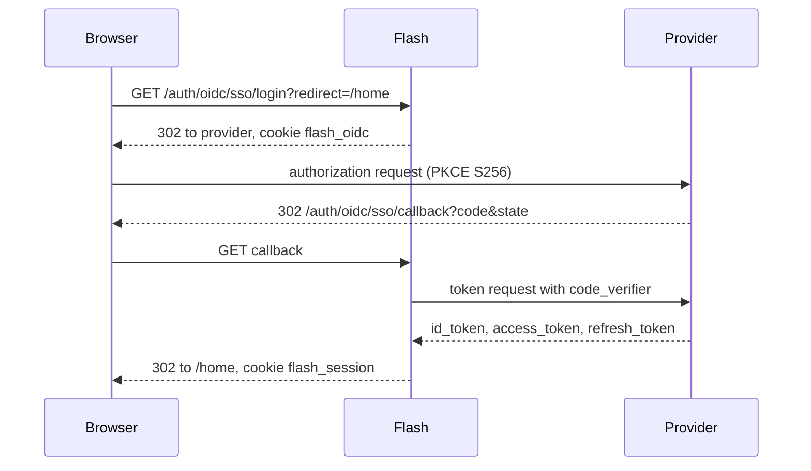

# Browser sign-in

`OidcModule` adds two routes per app and a login method per configured provider.

| Route | Behavior |
|---|---|
| `GET /auth/oidc/{provider}/login` | Starts the flow |
| `GET /auth/oidc/{provider}/callback` | Completes it |

## Login

Generates `state`, a PKCE `code_verifier` and a `nonce`, stores them with the target path in the
`flash_oidc` cookie (`Path=/auth/oidc; Max-Age=600; HttpOnly; SameSite=Lax`, plus `Secure` on
https), and redirects to the provider with `response_type=code`, the `S256` challenge, the scopes,
and the redirect URI `<origin>/auth/oidc/{provider}/callback`. The `redirect` query parameter is
where the user ends up, restricted to a same-origin path with `Redirects.localPath`.

Register `<origin>/auth/oidc/{id}/callback` as the redirect URI at the provider.

## Callback

1. Compares the `state` query value with the cookie in constant time. A mismatch, a missing cookie,
   or an `error` parameter is a `400`.
2. Exchanges the code at the token endpoint, authenticating with `client_secret_basic`.
3. Verifies the ID token (signature, issuer, audience equal to the client id, `sub` and `exp`
   present) and that its `nonce` matches.
4. Builds an `OidcPrincipal` and starts a session through `Security.signIn`, with expiry taken from
   `expires_in` (300 seconds if absent).
5. Redirects to the target path.

Any failure in steps 2 to 4 is a `400` with `Sign-in could not be completed; start again`. The
flow cookie is always cleared.

## Principal and logout

The principal's `name()` is the `sub` claim. `OidcPrincipal` exposes `provider()`, `issuer()`,
`email()`, `claim(name)`, `claims()`, `accessToken()` and `refreshToken()`. Claims are the ID
token's, plus the `scope` the token response granted.

If the provider publishes `end_session_endpoint`, the principal's `logoutUrl()` is that endpoint
with `client_id`, `id_token_hint` and `post_logout_redirect_uri=<origin>/`, so `POST /auth/logout`
also signs the user out at the provider.

## Refresh

`Oidc` is the session refresher for `OidcPrincipal`. When a session has expired it posts the
refresh token to the token endpoint. If that succeeds and the new ID token's `sub` is unchanged, the
session continues with the new tokens (the previous refresh token is kept if the response has none).
Otherwise the session ends.
