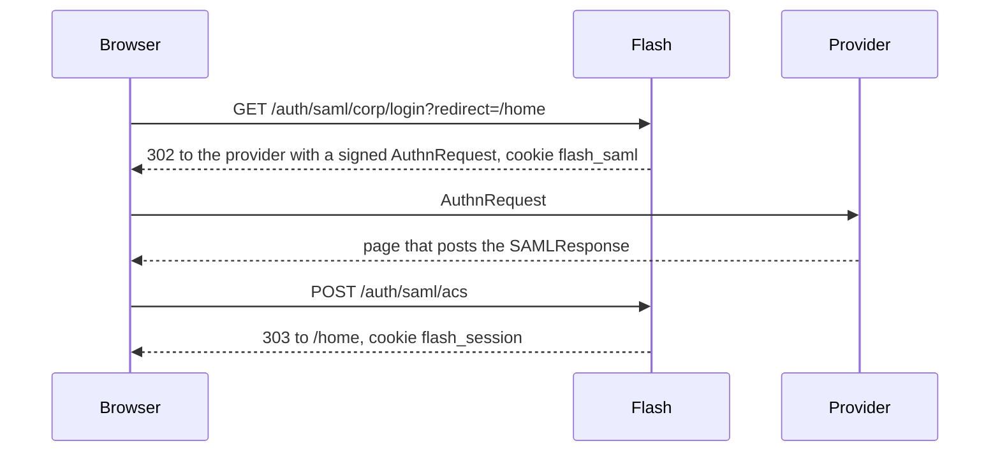

# Sign-in

`SamlModule` adds these routes, and a `LoginMethod` per configured provider.

| Route | Behavior |
|---|---|
| `GET /auth/saml/metadata` | The application's metadata, `application/samlmetadata+xml`, encoded once at start |
| `GET /auth/saml/{idp}/login?redirect=` | Starts a sign-in with that provider |
| `GET /auth/saml/login?entityID=&redirect=` | The same, with the provider named by entity ID: the return address of a discovery service |
| `POST /auth/saml/acs` | Completes it: the assertion consumer of every provider |
| `GET /auth/saml/slo` | Single Logout. See [logout.md](logout.md) |



## Login

The `AuthnRequest` is signed with RSA-SHA256, names the assertion consumer URL, asks for an HTTP-POST
response and sets no `NameIDPolicy`. It goes by HTTP-Redirect when the provider's metadata offers it, by
an auto-submitting HTTP-POST form otherwise.

Its ID and the `redirect` path, restricted to this origin by `Redirects.localPath`, are kept in the
`flash_saml` cookie: `Path=/auth/saml; Max-Age=600; HttpOnly`. Over https it is `SameSite=None; Secure`,
because the provider's response arrives as a cross-site POST that a `Lax` cookie does not ride. Over
http it is `SameSite=Lax`, which works in development where provider and application share
`localhost`.

## Checks

A response must pass every check below, in this order. Any failure is a `400` with
`Sign-in could not be completed; start again`, the same for every cause; the reason is logged at WARN.
A post without `SAMLResponse` is a `400` with `No SAMLResponse`. The cookie is always cleared, so a
sign-in started in a second tab replaces the first one's, which then fails.

1. It parses as XML without a document type declaration.
2. It is a SAML 2.0 `Response`. A status other than `Success` ends here with a `400` that names the
   provider's status code, when it is one SAML defines (`urn:oasis:names:tc:SAML:2.0:status:...`).
3. `Destination`, when present, equals the assertion consumer URL exactly. A signed response must have
   it.
4. It holds exactly one `Assertion` or `EncryptedAssertion`.
5. Its `Issuer` (or the assertion's, when the response has none) is a known provider whose metadata
   has not expired.
6. A signature on the response must verify with one of the provider's signing keys. With
   `signedResponses()`, it must be there.
7. `InResponseTo`, when present, equals the ID in this browser's `flash_saml` cookie.
8. An encrypted assertion is decrypted with one of the application's keys.
9. The assertion is SAML 2.0, from the same issuer. Its signature, when present, must verify. When the
   response was not signed, it must be there.
10. A bearer `SubjectConfirmation` has `Recipient` equal to the assertion consumer URL, a `NotOnOrAfter`
    that has not passed and is at most an hour away, no `NotBefore`, and an `InResponseTo` equal to the
    cookie's ID. Without `InResponseTo` the response is unsolicited.
11. `Conditions` is within its validity window, and every `AudienceRestriction` names this application.
    A condition other than `AudienceRestriction`, `OneTimeUse` and `ProxyRestriction` is refused.
12. There is an `AuthnStatement`. With `authnContext(...)`, its class must be one of those requested.
13. The user is identified (see below).
14. The assertion has not been consumed before.

A signature is accepted only when it is a direct child of the element it signs, its single reference
is that element's ID, and its transforms only remove the signature and canonicalize. The user and
every condition are read from that same element, never searched for again in the document, which is
what signature wrapping attacks rely on. Text is read whole: a comment inside a `NameID` does not cut
it short.

Then `Security.signIn` starts the session for `sessionTimeout`, or until the `AuthnStatement`'s
`SessionNotOnOrAfter` when the provider sets one that is sooner. The browser is sent to the `redirect`
path with `303`.

## The principal

`SamlPrincipal` holds `idp()`, `issuer()` (the provider's entity ID), `name()`, `nameId()`,
`sessionIndex()` and `attributes()`.

`name()` is the first of:

1. the `urn:oasis:names:tc:SAML:attribute:pairwise-id` attribute,
2. the `urn:oasis:names:tc:SAML:attribute:subject-id` attribute,
3. the `NameID`, decrypted when it is an `EncryptedID`.

An assertion with none of them is refused. A `pairwise-id` or `subject-id` must carry a non-empty scope
after `@`; when the provider's metadata declares `shibmd:Scope` values, the scope must equal one that is
not a regular expression. Regular expressions are not evaluated, so a provider that declares only those
can assert no scoped identifier.

The name is unique per issuer, never across issuers: two providers can both assert `alice`. Key your
users by `issuer()` and `name()` together, as `UserResolver` does for OIDC.

`attributes()` maps every attribute's `Name` to its values in order. `attribute(name)` returns the
first value. `FriendlyName` is not used. `claim(name)` returns the list, so roles come from an attribute
with `ClaimRoles`:

```java
new SecurityModule().roles(ClaimRoles.at("urn:oid:1.3.6.1.4.1.5923.1.5.1.1"))   // isMemberOf
```

The session stores the principal, so a custom `SessionStore` must persist it: it holds strings, lists,
maps and the `NameId` record of strings.

## Unsolicited responses

A provider's portal can post a response nobody asked for. It answers no request of this browser, so it
cannot be told apart from someone else's response posted through it: an attacker could sign a victim
into the attacker's account. Such responses are refused unless the provider is configured with
`unsolicited()`. Then the browser is sent to the `RelayState` the response carries, restricted to this
origin, or `/`.
