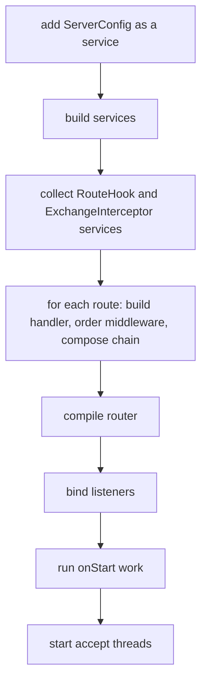

# App, Module and Server

`App` is the definition of an application: routes, middleware, modules and services. It has no port
and starts no thread. `Server` runs one `App` on the listeners described by a `ServerConfig`.
Tests run the same `App` object through `flash-testing`.

```java
App app = App.create()
        .install(new JsonModule())
        .add(UserService.class)
        .scan("com.acme.api")
        .get("/healthz", (req, res) -> "ok");

Server server = Server.start(app, ServerConfig.builder().port(8080).build());
server.await();
```

## App

Every method returns the `App`, so declarations chain. All declarations happen before
`Server.start`; afterwards `route`, `add` and the other mutators throw `IllegalStateException`.
An `App` can run on one server only.

| Method | Effect |
|---|---|
| `get`, `post`, `put`, `patch`, `delete` | Declare a route for one method. Take a lambda or a `Handler` |
| `any` | Declare the same handler under every `HttpMethod` |
| `route(method, path, handler, middleware...)` | Declare a route for any `HttpMethod`. The handler is a lambda, an instance or a class |
| `ws(path, handler, middleware...)` | Declare a WebSocket route |
| `scan(package)` | Declare every annotated handler class in a package, subpackages included |
| `use(middleware...)` | Middleware around every route of this app or mount |
| `mount(prefix, routes)` | Declare routes under a prefix. See [routing.md](routing.md#mounts) |
| `install(modules...)` | Run `Module.install(app)` for each module |
| `add(...)`, `replace(...)` | Register services. See [services.md](services.md) |
| `onStart(work)` | Run code once all services exist and before the first connection |
| `onError(handler)` | Replace the [error handler](errors.md) |
| `onNotFound(action)` | Replace the 404 handler |

`services()` returns the app's `Services`. It is readable only after the server has started.

## Module

```java
public final class Billing implements Module {
    @Override public void install(App app) {
        app.add(Invoices.class).scan("com.acme.billing");
    }
}
```

A module is a function of `App`. An extension is a module shipped in a jar, and an application can
split itself the same way. A module adds routes, middleware and services through the ordinary `App`
methods.

`Module.ifPresent(className, supplier)` returns the module from `supplier` when the named class is on
the classpath, and a module that does nothing otherwise. The class is checked with
`Class.forName(name, false, loader)`, so it is not initialized. Extensions use it to contribute to an
optional dependency without loading it:

```java
app.install(Module.ifPresent("dev.relism.flash.ext.openapi.OpenApiModule", OpenApiContribution::new));
```

## Server

`Server.start(app, config)` runs these steps in order:



A failure in any step closes the services already built and rethrows, so a broken app never accepts a
connection. A bind failure is thrown as `UncheckedIOException`.

| Method | Meaning |
|---|---|
| `port()` | Port of the first listener. With `port(0)` it is the one the OS chose |
| `ports()` | Ports of all listeners, in configuration order |
| `stop()` | Stops accepting, drains in-flight requests, closes services. Returns a `CompletableFuture<Void>` |
| `await()` | Blocks until the server has stopped |

`stop()` is described in [transport.md](transport.md#shutdown).

## Boot errors

Everything Flash can check without a request is checked in `start`:

- A handler class without exactly one usable constructor, a missing or ambiguous service, and a
  dependency cycle (reported with its path).
- Two routing annotations on one class, `@Ws` on a class that is not a `WebSocketHandler`, `@Sse`
  on a class that is not an `SseHandler`.
- `scan` of a package that contains no annotated handler.
- A middleware key declared twice on a route, a required ordering target that is absent, and an
  ordering cycle.
