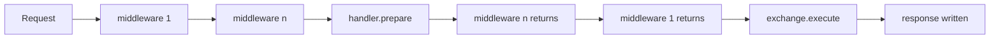

# Handlers

Every route is answered by a `Handler`, which has two families:

| Family | Base class | Lifecycle |
|---|---|---|
| Request and answer | `RequestHandler` | One request produces one response value |
| Duplex | `DuplexHandler` | The protocol owns the exchange after the handshake: [WebSocket](websocket.md), [SSE](sse.md), streams |

`Handler` is sealed: its only direct subclasses are `RequestHandler` and `DuplexHandler`. Middleware,
route hooks and exchange interceptors treat both the same way.

## RequestHandler

```java
@POST("/users")
final class CreateUser extends RequestHandler {
    private final UserService users;
    CreateUser(UserService users) { this.users = users; }

    @Override protected Object handle(Request req, Response res) throws Exception {
        long id = users.create(req.body().bytes());
        return res.status(201).header("Location", "/users/" + id);
    }
}
```

A lambda `(req, res) -> value` is wrapped in a `RequestHandler`. The value returned by `handle` is
interpreted as follows:

| Returned | Result |
|---|---|
| `null` | The current `Response`, as the handler left it |
| a `Response` | Replaces the current response. A new `Response` is allowed and is not pooled |
| `byte[]`, `String`, `CharSequence` | Becomes the body; strings are UTF-8 |
| anything else | `IllegalArgumentException`: serialize it first |

The current `Response` starts as `200` with `Content-Type: text/plain`. See [response.md](response.md).
Typed bodies (JSON, XML, protobuf) come from the codec extensions, which provide handler bases that
read and write objects.

## Thread safety and state

Flash builds one instance of each handler per declared route and calls it from many threads at once.
Keep fields immutable or thread-safe. Request state lives in the arguments, not in the handler.
Do not keep `Request` or `Response` past `handle`; they are reused for the next request (see
[request.md](request.md#lifetime)).

## Initialization

`onInit()` runs once, after construction and before the first request, with `services()` available.
Use it to validate configuration or precompute immutable state. A failure aborts the boot.

```java
@Override protected void onInit() {
    this.limit = services().get(ServerConfig.class).getMaxBodySize();
}
```

## DuplexHandler

A duplex handler separates the handshake from the protocol:

1. `prepare(request, response)` validates the request and sets status and headers. Nothing is sent.
2. Middleware that wraps the route returns, so it can still change status and headers.
3. Flash binds the transport and calls `handle(request, response, duplex)`.

`switchesProtocol(request)` tells HTTP/1.1 whether the connection leaves HTTP after the handshake.
`Duplex` is the raw byte channel; see [streaming.md](streaming.md#duplex). Extensions build
direction-specific handlers on it. `WebSocketHandler` and `SseHandler` are the two in core.

## How a request reaches a handler



Middleware wraps preparation: code after `next.handle(exchange)` still runs before any byte is sent
and can change status and headers. `execute` then runs what must happen after middleware: a
`Response.streaming` body or a duplex protocol. An exception anywhere in this path goes to the
[error handler](errors.md).
