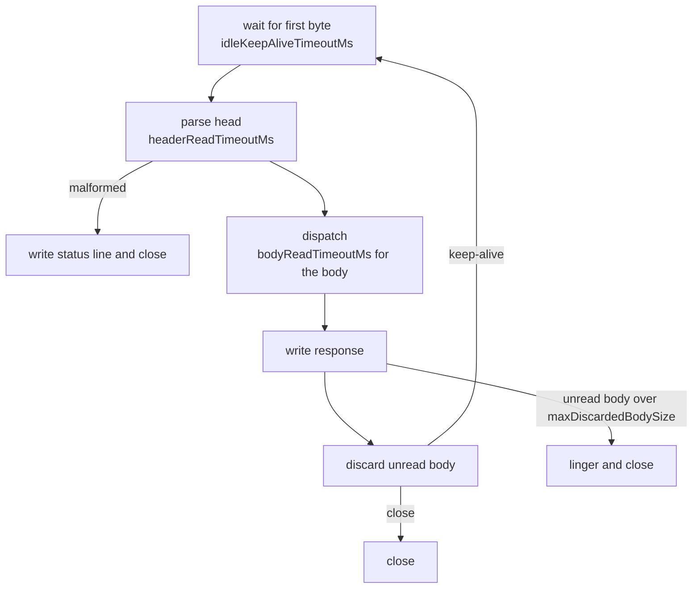

# HTTP/1.1

`Http1Connection` runs the keep-alive loop of one connection: read a request, dispatch it through the
router, write the response, repeat. `RequestParser` reads requests in place from the connection's
buffer, and `Http1ResponseWriter` writes responses.

## Request loop

- Pipelined requests already in the buffer are served without waiting for new bytes.
- When the idle timeout expires, the connection closes silently.
- A connection stays open if the request is HTTP/1.1 without `Connection: close`, or HTTP/1.0 with
  `Connection: keep-alive`. `Connection` is read as a token list, so `keep-alive, Upgrade` is understood.
- During [shutdown](transport.md#shutdown) the response in progress is sent with `Connection: close`.

## Unread bodies

A client sends the whole request body before it reads the answer. When a handler answers without
reading the body (a refused upload, say), discarding the rest would keep the client sending for
nothing. So after the response:

| Body left unread | Then |
|---|---|
| None, or a `Content-Length` of at most [`maxDiscardedBodySize`](config.md#limits) (2 MiB by default) | The rest is read and dropped, and the connection stays open |
| A larger `Content-Length`, or a chunked body not read to its end | The response carries `Connection: close`. The server stops writing (a half-close, except over TLS), reads and drops what still arrives for at most 2 seconds so the client can read the answer, then closes |

Some clients read the answer only once they have sent the whole body, and report a connection closed
before that as a network error: the Windows WebDAV client does. For them, a larger
`maxDiscardedBodySize` trades a refusal that arrives late, after the whole upload, for one they can
show.

## Request rules

The parser rejects a request before routing when it breaks one of these rules. The answer is a
minimal `text/plain` response with the status and a message, and the connection is closed.

| Condition | Status |
|---|---|
| Missing or malformed method, target or protocol on the request line, or a method that is not a token | 400 |
| Request line over 8,192 bytes | 431 |
| Head over [`maxHeaderBufferSize`](config.md#limits) | 431 |
| More than 100 header lines | 431 |
| Header name over 256 bytes, or value over 8,192 bytes | 431 |
| Header name with a character that is not a token character, or a line without `:` | 400 |
| Obsolete line folding (a line starting with space or tab) | 400 |
| A bare `CR` not followed by `LF` | 400 |
| Invalid `Content-Length` (empty, non-digit, over 19 digits, overflow) | 400 |
| Several `Content-Length` lines with different values | 400 |
| `Content-Length` and `Transfer-Encoding` together | 400 |
| `Transfer-Encoding` whose last coding is not `chunked` | 501 |
| `Content-Length` above [`maxBodySize`](config.md#limits) | 413 |

Rejecting ambiguous message boundaries and closing afterwards is deliberate: it removes the room that
request smuggling needs.

## Chunked bodies

A `Transfer-Encoding` whose final coding is `chunked` is decoded as the handler reads. Limits, each
answered with the status shown, thrown from the read:

| Limit | Value | Status |
|---|---|---|
| Bytes in one chunk | 16 MiB | 413 |
| Chunks per body | 100,000 | 413 |
| Total body | `maxBodySize` | 413 |
| Chunk size line | 16 hex digits, extensions 256 bytes | 400 |
| Trailer lines | 50, each at most 8,192 bytes | 431 |
| Trailer with a forbidden field or bad syntax | | 400 |
| Connection closed before the last chunk | | 400 |

A `Content-Length` body is held to its length the same way: when the connection closes before that
many bytes arrived, the read throws a 400 instead of ending the body early, so a handler never takes
a truncated upload for a whole one.

These are exceptions raised while the handler reads, so the app's [error handler](errors.md) answers
them like an `HttpException`.

Trailers are available from `Request.trailers()` after the body is read.

## Multipart limits

| Limit | Value |
|---|---|
| Parts per body | 1,000 |
| Header lines per part | 20 |
| One part header line | 8,192 bytes |
| One buffered part (text field, or any part under `parts()`) | 10 MiB |

Exceeding one throws `IOException` from the `Multipart` call.

## Responses

| Body | Framing |
|---|---|
| Fixed (`body`) | `Content-Length` |
| `stream(in, length)` | `Content-Length`, bytes relayed |
| `chunked(in)`, `streaming`, SSE, any response with trailers | `Transfer-Encoding: chunked` |
| `204`, `304`, `1xx` | No `Content-Length`, no body |
| Answer to `HEAD` | Headers only. Chunked responses declare `Transfer-Encoding` and send no chunk framing |

The head is written to a per-connection buffer: status line, `Content-Type` (omitted when
`ContentType.NONE`), `Date` (when enabled), your headers, then framing and `Connection`. A fixed body
of up to 8,192 bytes is copied after the head and sent in one write. Larger bodies follow in a
second write.

A response that fails after its head was sent cannot be replaced: Flash closes the connection.

## Protocol switch

A [`DuplexHandler`](handlers.md#duplexhandler) whose `switchesProtocol` is true answers with its
status (WebSocket: `101`), flushes it, and the connection then belongs to that protocol. The
request-loop deadlines no longer apply and the connection does not return to HTTP.
