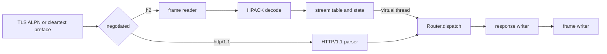

# HTTP/2

Flash serves HTTP/2 (RFC 9113) and HTTP/1.1 to the same application. Handlers, middleware, requests,
responses, trailers, streaming and WebSocket are the same types on both protocols. Application code
does not branch on the wire version.



## Enabling

```java
ServerConfig.builder()
        .port(8443)
        .tls(TlsConfig.keystore(Path.of("server.p12"), "changeit"))
        .http2Enabled(true)
        .build();
```

| Mode | Option | Selection |
|---|---|---|
| TLS | `http2Enabled(true)` | ALPN offers `h2` and `http/1.1`. The client picks |
| Cleartext | `http2CleartextEnabled(true)` | The first 24 bytes are `PRI * HTTP/2.0\r\n\r\nSM\r\n\r\n` |

Both are off by default and independent. See [config.md](../config.md#protocol).

## Cleartext

Cleartext HTTP/2 uses prior knowledge (RFC 9113 section 3.3): the client opens the connection with the
HTTP/2 preface. One plaintext port serves both protocols: Flash peeks at the first bytes without
consuming them, and anything other than the exact preface is HTTP/1.1. The `Upgrade: h2c` mechanism
is not implemented.

## What is advertised

At connection start Flash sends `SETTINGS` and raises the connection window:

| Setting | Value |
|---|---|
| `SETTINGS_HEADER_TABLE_SIZE` | 4,096 |
| `SETTINGS_ENABLE_PUSH` | 0 |
| `SETTINGS_MAX_CONCURRENT_STREAMS` | 64 |
| `SETTINGS_INITIAL_WINDOW_SIZE` | 1,048,576 |
| `SETTINGS_MAX_HEADER_LIST_SIZE` | 32,768 |
| `SETTINGS_ENABLE_CONNECT_PROTOCOL` | 1 |
| `SETTINGS_MAX_FRAME_SIZE` | not sent: the protocol default 16,384 applies |

A `WINDOW_UPDATE` on stream 0 raises the connection receive window from 65,535 to 1,048,576.

## Not implemented

- Server push. Flash advertises `ENABLE_PUSH = 0` and never sends `PUSH_PROMISE`. A `PUSH_PROMISE`
  from a client is a connection error.
- Priority scheduling (RFC 7540 trees, deprecated by RFC 9113). `PRIORITY` frames are validated and
  ignored.
- `Upgrade: h2c`, removed by RFC 9113.

## Pages

| Page | Content |
|---|---|
| [connection.md](connection.md) | Preface, SETTINGS, control frames, shutdown |
| [streams.md](streams.md) | Stream table, state machine, request assembly, dispatch, WebSocket CONNECT |
| [flow-control.md](flow-control.md) | Receive windows, request bodies, response backpressure |
| [hpack.md](hpack.md) | Header compression |
| [response-writer.md](response-writer.md) | Response frames and the serialized socket writer |
| [limits.md](limits.md) | Every bound and what happens when it is exceeded |
| [testing.md](testing.md) | Compliance, interoperability and fuzz tests |
