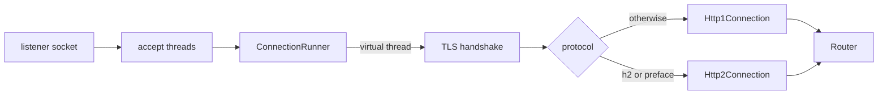

# Transport

The transport layer binds sockets, accepts connections, picks the HTTP version, and runs one
connection per virtual thread.

## Listeners and accepting

`Server.start` binds every listener with `SO_REUSEADDR`, a 4,096 connection backlog and 256 KiB
socket buffers. Make sure `net.core.somaxconn` is at least 4,096 on Linux, otherwise the kernel caps
the backlog silently.

Each listener has `min(availableProcessors, 8)` platform accept threads. An accepted socket is handed
to an executor that starts a **virtual thread per connection**. Handlers run on virtual threads, so
blocking I/O inside a handler is fine; HTTP/2 streams are also dispatched to virtual threads.

At accept time, if the number of open connections has reached
[`maxConnections`](config.md#limits), the socket is closed at once.

## Per-connection setup

For each connection, in this order:

1. Take reusable buffers from a bounded pool: up to `min(availableProcessors * 64, 4096)` are kept,
   extras are left to the garbage collector.
2. `TCP_NODELAY` on; 256 KiB send buffer.
3. For TLS: the handshake, under `headerReadTimeoutMs`.
4. Choose the protocol:
   - TLS: the ALPN result. `h2` selects HTTP/2, anything else HTTP/1.1.
   - Plaintext with `http2CleartextEnabled`: peek the first 24 bytes. If they are the HTTP/2
     preface `PRI * HTTP/2.0\r\n\r\nSM\r\n\r\n` the connection is HTTP/2, otherwise HTTP/1.1. The
     peek does not consume bytes.
   - Plaintext without `http2CleartextEnabled`: HTTP/1.1, with no peek.
5. Run `Http1Connection` or `Http2Connection` until it ends, then release buffers and close.

The decision is made once. The two protocol packages do not depend on each other; this is checked by
`PackageBoundaryTest`.

## Errors

An `IOException` on a connection closes it. A `SocketException` is logged at debug level, other I/O
errors at error level, unless the server is stopping. Failures are isolated to the connection.

## Shutdown

`Server.stop()`:

1. Closes the listener sockets, so no new connection is accepted.
2. Marks the server stopped. HTTP/1.1 connections finish the request in progress, answer it with
   `Connection: close`, and exit instead of waiting for another request. HTTP/2 connections start
   a graceful GOAWAY (see [http2/connection.md](http2/connection.md#shutdown)).
3. Polls until all connections are gone or `shutdownDrainTimeoutMs` has passed, then closes what
   is left.
4. Closes the app's services.

The returned future completes after the last step. `Server.await()` returns once the accept threads
have ended.
